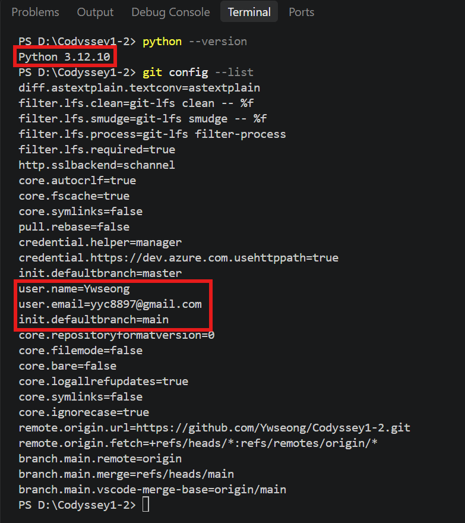
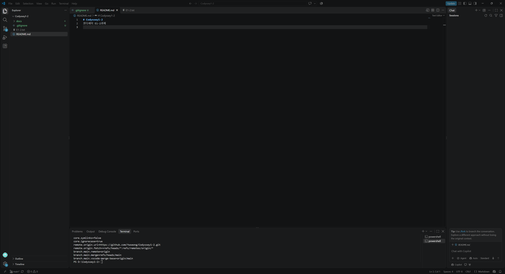

# Codyssey1-2 나만의 퀴즈 게임

코디세이 E1-2 과제

## 1. 프로젝트 개요
터미널에서 동작하는 Python 콘솔 퀴즈 게임이다. 메뉴에서 번호를 골라 퀴즈를 풀고, 추가하고, 목록과 최고 점수를 확인할 수 있다. 퀴즈와 최고 점수는 `state.json`에 저장돼 프로그램을 다시 실행해도 유지된다.

## 2. 퀴즈 주제와 선정 이유
(작성 예정)

## 3. 실행 방법
- Python 3.10 이상 (외부 라이브러리 없음)
- 개발 환경: Windows 11, VSCode, Python 3.12.10

```bash
python main.py      # Windows
python3 main.py     # Linux / macOS
```

### 개발 환경 - Python, Git 설정


### 개발 환경 - VSCode


## 4. 기능 목록
| 메뉴 | 기능 | 
|---|---|
| 1. 퀴즈 풀기 | (작성 예정) | 
| 2. 퀴즈 추가 | (작성 예정) |
| 3. 퀴즈 목록 | (작성 예정) |
| 4. 점수 확인 | (작성 예정) |
| 5. 종료 | (작성 예정) |

입력 예외 처리: (작성 예정)

## 5. 파일 구조
```
Codyssey1-2/
├── .gitignore
├── README.md
├── main.py          (작성 예정)
└── docs/
    └── screenshots/
```

## 6. 데이터 파일 설명 (state.json)
- 경로: 프로젝트 루트의 `state.json`
- 역할: 퀴즈 목록과 최고 점수를 UTF-8로 저장
- 실행 중 계속 바뀌는 데이터라 `.gitignore`로 저장소에서 제외했다. 파일이 없으면 기본 퀴즈로 시작하고 새로 만든다.
- 구조: (작성 예정)

## 7. 실행 화면
(작성 예정)

## 8. Git 작업 기록
(작성 예정)

## 9. 트러블슈팅
(진행 중 생기면 추가)