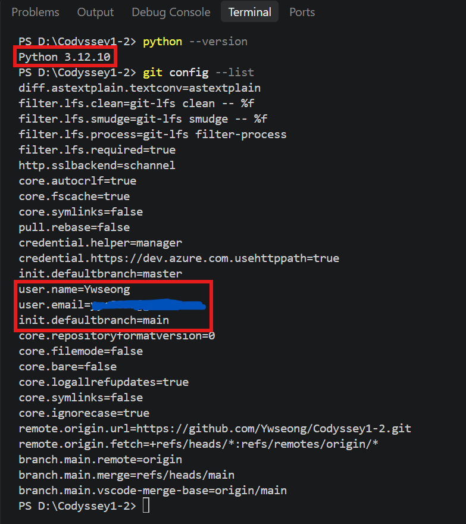
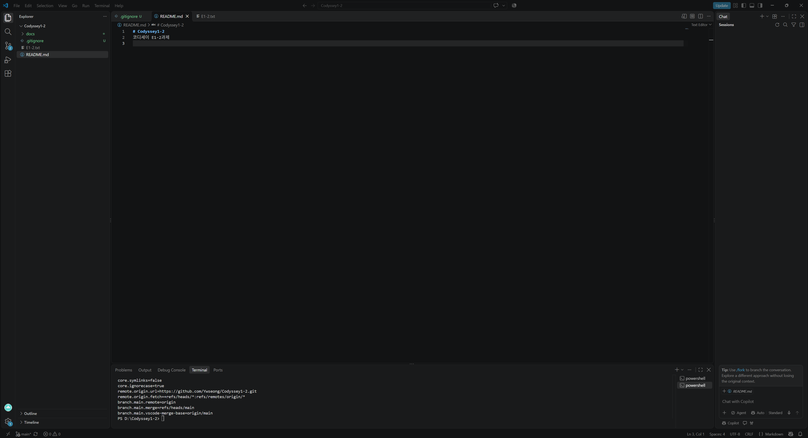
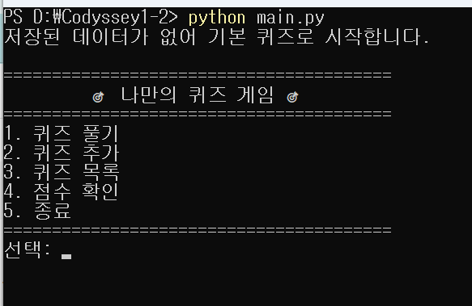
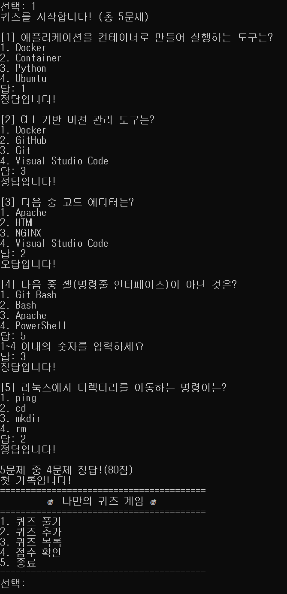
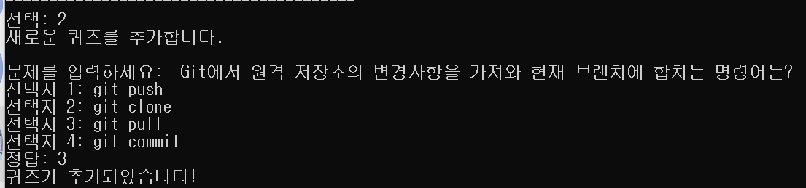
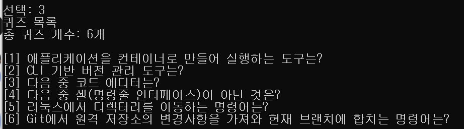
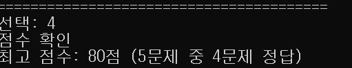
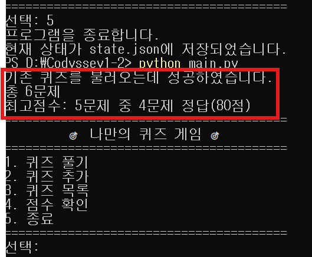
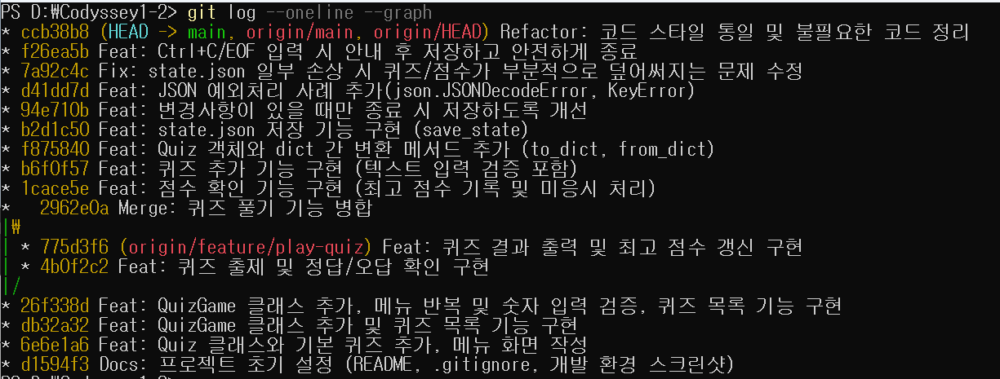

# Codyssey1-2 나만의 퀴즈 게임
 
코디세이 E1-2 과제
 
## 1. 프로젝트 개요
터미널에서 동작하는 Python 콘솔 퀴즈 게임이다. 메뉴에서 번호를 골라 퀴즈를 풀고, 추가하고, 목록과 최고 점수를 확인할 수 있다. 퀴즈와 최고 점수는 `state.json`에 저장돼 프로그램을 다시 실행해도 유지된다.
 
코드는 두 클래스로 나눴다.
 
- `Quiz`: 퀴즈 한 문제. 문제, 선택지 4개, 정답 번호를 갖고 있고 문제 출력, 정답 확인, dict 변환을 맡는다.
- `QuizGame`: 게임 전체. 퀴즈 목록과 최고 점수를 갖고 있고 메뉴, 입력 검증, 퀴즈 풀기/추가/목록/점수 확인, 파일 저장과 불러오기를 맡는다.
## 2. 퀴즈 주제와 선정 이유
주제는 개발 도구와 개발 환경이다. Docker, Git, VSCode, 셸, 리눅스 명령어처럼 코디세이 E1-1, E1-2를 진행하면서 직접 설치하고 써본 도구들로 문제를 만들었다. 실습하면서 헷갈렸던 개념(IDE와 코드 에디터의 차이, 셸이 무엇인지, Git과 GitHub의 차이 등)을 문제로 다시 정리해 보려고 이 주제를 골랐다.
 
## 3. 실행 방법
- Python 3.10 이상 (외부 라이브러리 없음)
- 개발 환경: Windows 11, VSCode, Python 3.12.10
프로젝트 폴더에서 실행한다. `state.json`이 실행한 위치 기준으로 저장되기 때문이다.
 
```bash
cd Codyssey1-2
python main.py      # Windows
python3 main.py     # Linux / macOS
```
 
### 개발 환경 - Python, Git 설정

 
### 개발 환경 - VSCode

 
## 4. 기능 목록
| 메뉴 | 기능 |
|---|---|
| 1. 퀴즈 풀기 | 저장된 퀴즈를 순서대로 출제한다. 정답 번호(1~4)를 입력하면 정답/오답을 알려주고, 모두 풀면 "N문제 중 M문제 정답 (점수)"를 보여준다. 점수는 100점 만점으로 반올림한다. 최고 점수보다 높으면 기록을 갱신한다. |
| 2. 퀴즈 추가 | 문제, 선택지 4개, 정답 번호를 입력받아 새 퀴즈를 등록한다. |
| 3. 퀴즈 목록 | 등록된 퀴즈의 번호와 문제를 보여준다. 선택지와 정답은 표시하지 않는다. |
| 4. 점수 확인 | 최고 점수와 그때의 문제 수, 정답 수를 보여준다. 아직 풀지 않았으면 안내 메시지를 출력한다. |
| 5. 종료 | 변경사항(퀴즈 추가, 최고 점수 갱신)이 있으면 `state.json`에 저장하고 종료한다. 변경이 없으면 저장하지 않는다. |
 
### 입력 예외 처리
| 상황 | 처리 |
|---|---|
| 앞뒤 공백 (예: ` 1 `) | 공백을 제거하고 처리 |
| 숫자가 아닌 입력 (예: `abc`, `3.0`) | 안내 후 다시 입력 |
| 범위 밖 숫자 (예: 메뉴 9, 정답 0) | 안내 후 다시 입력 |
| 빈 입력 (그냥 Enter) | 안내 후 다시 입력 |
| 퀴즈 추가 시 빈 문제/선택지 | 안내 후 다시 입력 |
| 퀴즈가 0개일 때 풀기/목록 | 퀴즈를 추가하라는 안내 후 메뉴로 |
| Ctrl+C, EOF(Ctrl+Z/Ctrl+D) | 안내 메시지 출력 후, 변경사항이 있으면 저장하고 종료 |
 
숫자 입력은 `get_number(prompt, min_value, max_value)`, 문자 입력은 `get_text(prompt)` 한 곳에서 검증하고 메뉴, 정답 입력, 퀴즈 추가에서 같이 쓴다.
 
## 5. 파일 구조
```
Codyssey1-2/
├── .gitignore
├── README.md
├── main.py              # Quiz, QuizGame 클래스와 실행 코드
├── state.json           # 실행 후 생성 (.gitignore로 저장소에서 제외)
└── docs/
    └── screenshots/     # README용 실행 화면
```
 
## 6. 데이터 파일 설명 (state.json)
- 경로: 프로젝트 루트의 `state.json`
- 역할: 퀴즈 목록과 최고 점수 기록을 UTF-8로 저장
- 실행 중 계속 바뀌는 데이터라 `.gitignore`로 저장소에서 제외했다. 그래서 저장소를 clone한 직후에는 파일이 없고, 코드 안의 기본 퀴즈 5개로 시작한다.
### 구조
```json
{
    "quizzes": [
        {
            "question": "CLI 기반 버전 관리 도구는?",
            "choices": ["Docker", "GitHub", "Git", "Visual Studio Code"],
            "answer": 3
        }
    ],
    "best_score": {
        "score": 80,
        "total": 5,
        "correct": 4
    }
}
```
 
| 키 | 타입 | 설명 |
|---|---|---|
| `quizzes` | list | 퀴즈 목록 |
| `quizzes[].question` | str | 문제 |
| `quizzes[].choices` | list(str) | 선택지 4개 |
| `quizzes[].answer` | int | 정답 번호 (1~4) |
| `best_score.score` | int 또는 null | 최고 점수. 아직 안 풀었으면 null |
| `best_score.total` | int | 최고 점수를 낸 판의 문제 수 |
| `best_score.correct` | int | 최고 점수를 낸 판의 정답 수 |
 
### 불러오기 동작
| 상황 | 퀴즈 | 최고 점수 |
|---|---|---|
| 파일 없음 (첫 실행) | 기본 퀴즈 5개 | 기록 없음 |
| JSON 문법 오류 (JSONDecodeError) | 기본 퀴즈 5개 | 기록 없음 |
| 퀴즈 데이터 키/타입 오류 (KeyError, TypeError) | 기본 퀴즈 5개 | 기록 없음 |
| 퀴즈는 정상, 점수 데이터만 깨짐 | 파일의 퀴즈 | 기록 없음 (안내 출력) |
| 정상 | 파일의 퀴즈 | 파일의 기록 |
 
파일을 끝까지 다 읽은 다음에 한 번에 반영하도록 만들어서, 중간에 오류가 나도 퀴즈가 일부만 들어간 상태로 시작하지 않는다.
 
### JSON 저장 방식의 한계
이 과제 규모(퀴즈 수십~수천 개, 한 사람이 사용)에서는 JSON 파일 하나로 충분하다. 퀴즈 하나가 200~300바이트 정도라 1000개를 넣어도 파일은 수백 KB이고, 읽고 쓰는 시간도 체감되지 않는다. 사람이 파일을 열어 바로 내용을 확인할 수 있다는 장점도 있다.
 
다만 데이터가 커지거나 사용 환경이 바뀌면 아래 한계가 드러난다.
 
| 한계 | 이 프로그램에서 나타나는 모습 |
|---|---|
| 일부만 읽을 수 없음 | `json.load`는 파일 전체를 끝까지 읽어야 dict를 돌려준다. 퀴즈 10개만 필요해도 전부 읽는다. |
| 일부만 고칠 수 없음 | 퀴즈 1개를 추가해도 저장할 때 파일 전체를 다시 쓴다. |
| 전부 메모리에 올라감 | 시작할 때 모든 퀴즈를 Quiz 객체로 만들어 들고 있는다. |
| 동시 사용에 약함 | 프로그램을 두 개 띄워 각각 퀴즈를 추가하면 나중에 저장한 쪽 내용만 남는다. |
| 저장 도중 중단에 약함 | `"w"` 모드는 파일을 먼저 비우고 쓰기 때문에, 쓰는 중에 꺼지면 파일이 깨질 수 있다. |
| 조회 기능이 없음 | "Git 관련 문제만" 같은 조건 검색을 하려면 전부 읽은 뒤 코드로 직접 걸러야 한다. |
| 값 검증이 없음 | `answer`에 문자열이 들어가도 문법만 맞으면 그대로 읽힌다. |
 
일부는 JSON 안에서도 보완할 수 있다. 한 줄에 퀴즈 하나씩 쓰는 JSON Lines 형식을 쓰면 원하는 만큼만 읽거나 파일 끝에 한 줄만 덧붙일 수 있고, 임시 파일에 먼저 쓴 뒤 원래 파일과 바꿔치기하면 저장 중 중단에도 기존 파일이 남는다.
 
### 데이터베이스가 필요해지는 시점
여러 사람이 동시에 쓰거나, 데이터가 많아져 필요한 부분만 꺼내 써야 하거나, 조건으로 검색해야 하는 상황이 오면 데이터베이스를 쓰는 게 맞다. 데이터베이스는 필요한 행만 추가·수정하고, `SELECT ... WHERE ... LIMIT 10`처럼 조건과 개수를 지정해 가져오고, 동시에 접근해도 데이터가 꼬이지 않게 관리해 준다. 컬럼 타입을 정해두면 잘못된 값이 들어가는 것도 막을 수 있다.
 
Python에는 표준 라이브러리로 `sqlite3`가 있어서 외부 설치 없이 파일 하나짜리 데이터베이스를 쓸 수 있다. 이 프로그램을 확장한다면 저장 부분(`load_json`, `save_state`)만 sqlite3로 바꾸고, 나머지 게임 로직은 Quiz 객체를 그대로 쓰는 방식으로 옮길 수 있다.
 
## 7. 실행 화면
 
### 메뉴

 
### 퀴즈 풀기

 
### 퀴즈 추가

 
### 퀴즈 목록

 
### 점수 확인

 
### 재시작 후 데이터 유지

 
## 8. Git 작업 기록
 
### 저장소 초기 설정
로컬 폴더를 Git 저장소로 만들고 GitHub 원격 저장소에 연결했다.
 
```powershell
git init
git add .
git commit -m "Docs: 프로젝트 초기 설정 (README, .gitignore, 개발 환경 스크린샷)"
git branch -M main
git remote add origin https://github.com/Ywseong/Codyssey1-2.git
git push -u origin main
```
 
### 브랜치 작업 (퀴즈 풀기)
퀴즈 풀기 기능은 `feature/play-quiz` 브랜치에서 만들고 main에 병합했다. 브랜치에서 작업하는 동안 main에 새 커밋이 없어서 그냥 병합하면 fast-forward로 일직선이 되기 때문에, `--no-ff`로 병합 커밋을 남겼다.
 
```powershell
git checkout -b feature/play-quiz
# 퀴즈 풀기 구현 후 커밋 2개
git push -u origin feature/play-quiz
git checkout main
git merge --no-ff feature/play-quiz -m "Merge: 퀴즈 풀기 기능 병합"
git push
```
 
### 커밋 그래프

 
### clone / pull 실습
(작성 예정)
 
### 기초 명령어 사용 현황
| 명령어 | 사용 |
|---|---|
| init | O |
| add | O |
| commit | O |
| push | O |
| checkout | O |
| clone | O |
| pull | (실습 후 O) |
 
## 9. 트러블슈팅
 
### PowerShell에서 `python3`를 입력하면 Microsoft Store 안내가 뜸
- 증상: `python3 --version` 실행 시 "Python was not found; run without arguments to install from the Microsoft Store..." 출력
- 원인: Windows에는 `python3`라는 이름의 앱 실행 별칭(Store 바로가기)이 기본으로 있고, python.org 설치 파일은 `python`과 `py`라는 이름으로 등록된다.
- 해결: Windows에서는 `python` 또는 `py`로 실행한다.
### state.json이 일부만 깨졌을 때 퀴즈가 일부만 불러와짐
- 증상: 중간 퀴즈 하나의 `answer`가 빠진 파일로 실행하면 "기본 퀴즈로 시작합니다"가 출력되는데, 실제 목록에는 그 앞의 퀴즈 몇 개만 남아 있었다.
- 원인: 불러오기에서 `self.quizzes = []`로 먼저 비우고 하나씩 채웠다. 중간에 KeyError가 나면 기본 퀴즈는 이미 지워졌고 앞의 퀴즈만 남은 채로 except로 넘어갔다.
- 해결: 퀴즈와 점수를 지역 변수에 먼저 다 읽은 다음, 성공했을 때만 한 번에 반영하도록 바꿨다. 점수도 같은 방식으로 세 값을 다 읽은 뒤에 반영한다.
### `"answer"` 줄을 지웠는데 KeyError가 아니라 JSONDecodeError가 남
- 증상: 손상 테스트로 `"answer"` 줄을 지웠는데 KeyError 처리 대신 파일 손상 메시지가 나왔다.
- 원인: 윗줄 끝의 쉼표가 남아 있었다. JSON은 마지막 항목 뒤 쉼표를 허용하지 않아서 문법 오류가 됐다.
- 해결: 윗줄 쉼표까지 지워서 키만 없는 경우를 따로 테스트했다. JSONDecodeError는 문법 오류, KeyError는 문법은 맞지만 키가 없는 경우라는 차이를 확인했다.
### `"best_score": null`, `"quizzes": null`일 때 프로그램이 멈춤
- 증상: 값을 null로 바꾸면 Traceback으로 종료됐다.
- 원인: None에서 `["score"]`로 꺼내거나 None을 for로 돌리면 TypeError가 난다. KeyError만 처리하고 있었다.
- 해결: except에 TypeError를 추가했다.
### f-string 안의 따옴표
- 증상: `f"총 {len(state["quizzes"])}문제"`가 Python 3.12에서는 동작했다.
- 원인: f-string 안에서 바깥과 같은 따옴표를 쓰는 문법은 3.12부터 허용된다. 과제 조건은 3.10 이상이라 3.10, 3.11에서는 SyntaxError가 난다.
- 해결: 안쪽은 작은따옴표로 바꾸거나 다른 변수를 쓰도록 수정했다.
### 알려진 한계
- `state.json`을 직접 고쳐서 `answer`를 문자열(`"3"`)이나 범위 밖 숫자(`7`)로 넣으면, 불러오기는 되지만 그 문제는 정답 처리가 되지 않는다. 불러올 때 키가 있는지만 확인하고 값의 타입과 범위는 검사하지 않는다.